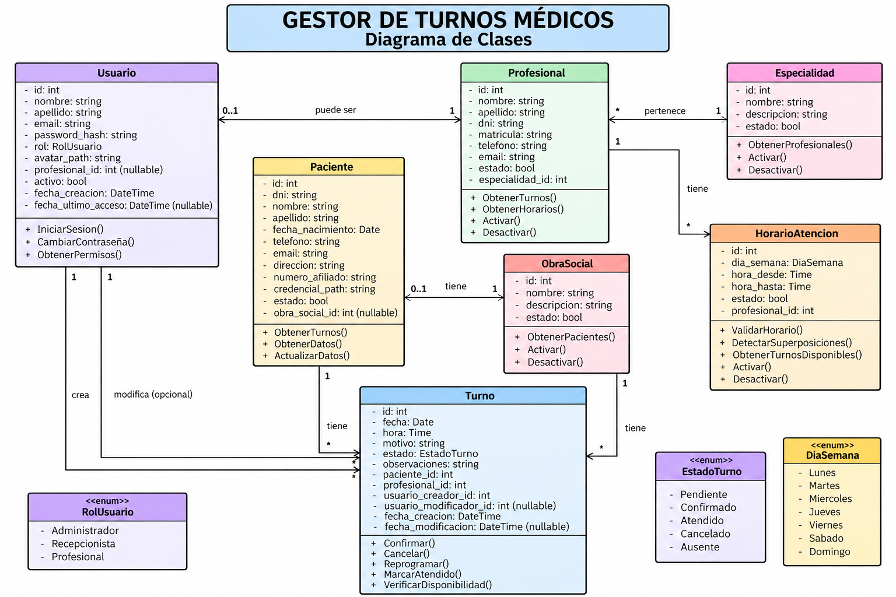
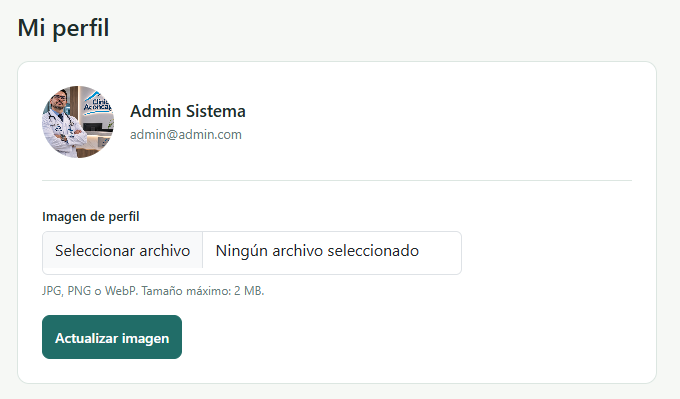
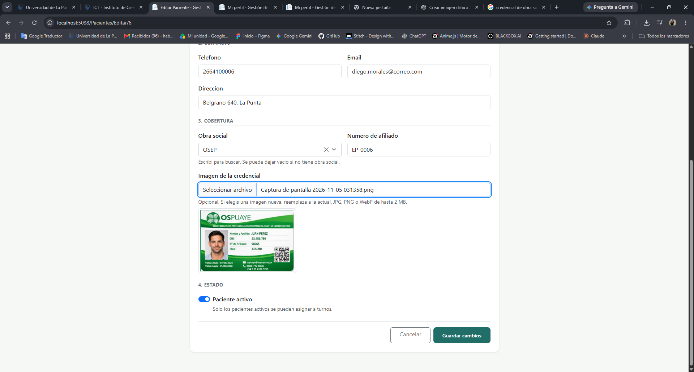
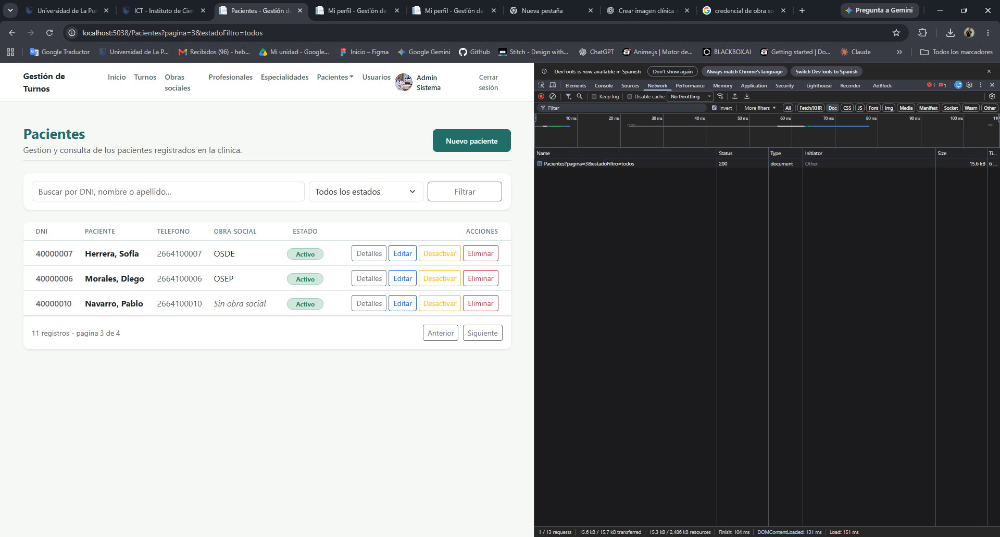
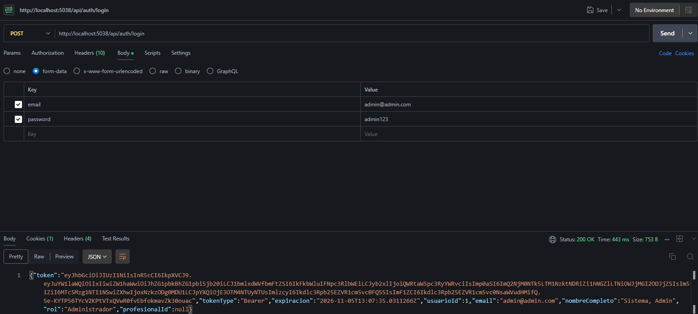
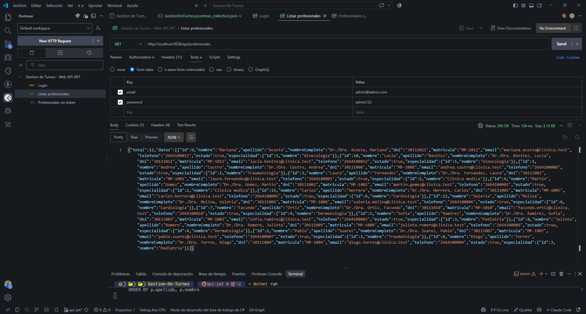
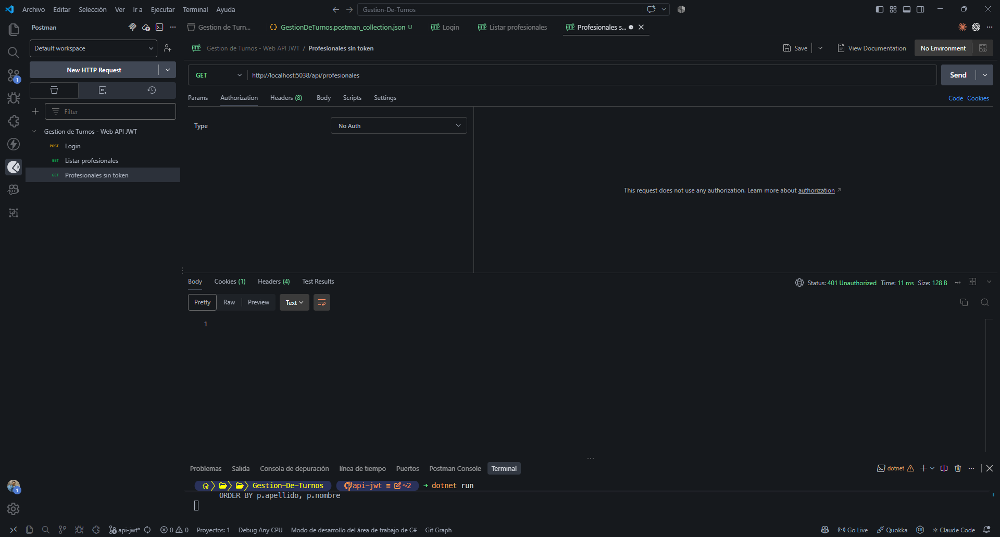

# Aconcagua Salud

Sistema web de gestion de turnos medicos para la Clinica Aconcagua.

Proyecto Integrador Final - Laboratorio de Programacion II - Universidad de La Punta (ULP)

## Integrantes

- Heber Gomez
- Nehuen Zerda
- Jose Garces

## Descripcion del proyecto

La Clinica Aconcagua necesita organizar la atencion de sus pacientes. Sin un sistema, la asignacion de turnos, el control de la agenda de cada profesional y la informacion de pacientes y obras sociales se llevan de forma manual, con superposicion de turnos y datos dispersos.

Aconcagua Salud centraliza esa gestion en una aplicacion web:

- Alta, baja y modificacion de pacientes, con su obra social y credencial escaneada.
- Alta y gestion de profesionales, especialidades y horarios de atencion.
- Asignacion y cancelacion de turnos, vinculando paciente, profesional y usuario que los registra.
- Gestion de obras sociales mediante una pantalla dinamica (Vue 3) sin recarga de pagina.
- Informes de pacientes (por obra social, sin turnos, con mas turnos) e informes de turnos.
- Usuarios con roles (Administrador, Recepcionista, Profesional) y permisos diferenciados.
- Web API REST protegida con JWT para clientes externos.

## Tecnologias

- ASP.NET Core MVC (.NET 10), namespace `mvc`
- Entity Framework Core 10 con Npgsql
- PostgreSQL
- Vue 3 (ABM de Obras Sociales) con `fetch` y JSON
- jQuery y Select2 (busqueda asincrona en formularios)
- Autenticacion por cookie (sitio) y JWT Bearer (Web API)
- Bootstrap

## Como ejecutar el proyecto

Requisitos: .NET 10 SDK y PostgreSQL.

1. Crear la base de datos vacia (por ejemplo `Gestion-Turnos`).
2. Ejecutar el script `schema.sql` (raiz del repositorio) sobre esa base. Crea el tipo `rol_enum` y las 7 tablas.
3. Crear el archivo `appsettings.Development.json` (esta en `.gitignore`, por eso no viene en el repo) con la cadena de conexion:

```json
{
  "ConnectionStrings": {
    "DefaultConnection": "Host=localhost;Port=5432;Database=Gestion-Turnos;Username=postgres;Password=TU_CONTRASENA"
  }
}
```

4. Ejecutar `dotnet run`. Al iniciar, el sistema crea los usuarios Administrador y Recepcionista.
5. Cargar los datos de prueba con `docs/datos_prueba.sql` (es re-ejecutable).
6. Ejecutar `dotnet run` de nuevo. Se crea el usuario Profesional, que requiere el profesional cargado en el paso anterior.

La aplicacion queda disponible en `http://localhost:5038`.

Los archivos subidos (avatares y credenciales) se guardan en `wwwroot/uploads/`, carpeta excluida del repositorio.

## Credenciales de prueba

| Rol           | Email                   | Contrasena     |
| ------------- | ----------------------- | -------------- |
| Administrador | admin@admin.com         | admin123       |
| Recepcionista | recepcion@clinica.com   | recepcion123   |
| Profesional   | profesional@clinica.com | profesional123 |

## Matriz de evidencias de requerimientos minimos

| Requerimiento minimo                                                   | Estado   | Enlace al codigo / controladores                                                                                                                                                                                                                | Evidencia                                                                                                                                                                                                                                                                        |
| ---------------------------------------------------------------------- | -------- | ----------------------------------------------------------------------------------------------------------------------------------------------------------------------------------------------------------------------------------------------- | -------------------------------------------------------------------------------------------------------------------------------------------------------------------------------------------------------------------------------------------------------------------------------- |
| 1. 6 o mas tablas, relacion 1:N y N:M (o entidad dependiente de otras) | Cumplido | [schema.sql](schema.sql), [AppDbContext](Models/AppDbContext.cs)                                                                                                                                                                                | Diagrama de clases:                                                                                                                                                                                                                    |
| 2. Login, roles y avatar                                               | Cumplido | [AccountController](Controllers/AccountController.cs), [AvatarStorageService](Services/AvatarStorageService.cs), [UsuariosController](Controllers/UsuariosController.cs)                                                                        |                                                                                                                                                                                                                             |
| 3. Manejo de archivos (credencial del paciente)                        | Cumplido | [CredencialStorageService](Services/CredencialStorageService.cs), [PacientesController](Controllers/PacientesController.cs)                                                                                                                     |                                                                                                                                                                                                                      |
| 4. ABM en Vue.js + AJAX                                                | Cumplido | [ObrasSocialesController](Controllers/ObrasSocialesController.cs), [obrasSociales.js](wwwroot/js/obrasSociales.js)                                                                                                                              |                                                                                                                                                                                                                                 |
| 5. Paginado por servidor                                               | Cumplido | [ResultadoPaginado](Models/ResultadoPaginado.cs), usado en Especialidades, Profesionales, Usuarios, Pacientes, Obras Sociales e Informes de Pacientes                                                                                           |                                                                                                                                                                                                                       |
| 6. Seleccion asincrona (AJAX)                                          | Cumplido | `Buscar` en [ObrasSocialesController](Controllers/ObrasSocialesController.cs) y [PacientesController](Controllers/PacientesController.cs); `BuscarPacientes` y `BuscarProfesionales` en [TurnosController](Controllers/TurnosController.cs)     |                                                                                                                                                                                                                           |
| 7. Web API + JWT                                                       | Cumplido | [AuthApiController](Controllers/Api/AuthApiController.cs), [ProfesionalesApiController](Controllers/Api/ProfesionalesApiController.cs), [EspecialidadesApiController](Controllers/Api/EspecialidadesApiController.cs), [Program.cs](Program.cs) |   . Coleccion: [docs/GestionDeTurnos.postman_collection.json](docs/GestionDeTurnos.postman_collection.json) |

### Notas sobre la matriz

- **Requisito 1:** el modelo tiene 7 tablas. Hay relaciones 1:N (especialidad-profesional, obra social-paciente, profesional-horario de atencion, paciente-turno, profesional-turno). La relacion N:M entre paciente y profesional se resuelve a traves de `turno`, que ademas depende de `usuario` (creador y modificador).
- **Requisito 2:** hay funcionalidades restringidas por rol. Por ejemplo, eliminar pacientes y obras sociales es solo para Administrador, y la gestion de usuarios, especialidades (alta y edicion) y profesionales (alta y edicion) tambien. Los informes de pacientes y las obras sociales son solo para Administrador y Recepcionista.
- **Requisito 3:** el archivo adicional al avatar es la credencial (foto del carnet) del paciente, guardada en el servidor.
- **Requisito 5:** el paginado en 3 registros por pagina es intencional, para poder mostrar el paginado con pocos datos. El valor se cambia en las constantes de los controladores y en `obrasSociales.js`.

## Como probar la Web API (JWT)

La web no consume la API, por eso se prueba con Postman. La coleccion esta en `docs/GestionDeTurnos.postman_collection.json` (importarla desde Postman).

1. Con la aplicacion corriendo, ejecutar el request **Login**: `POST http://localhost:5038/api/auth/login`.
   - Body: **form-data** con las claves `email` y `password` (el endpoint usa `[FromForm]`).
   - La respuesta es un JSON con el campo `token`.
2. Copiar el valor de `token` y pegarlo en Authorization (Bearer Token) del request **Listar profesionales**: `GET /api/profesionales`.
3. El request **Profesionales sin token** muestra que sin token la API responde 401.

Endpoints disponibles (todos requieren token, salvo el login):

| Metodo | Ruta                       | Descripcion                                                             |
| ------ | -------------------------- | ----------------------------------------------------------------------- |
| POST   | `/api/auth/login`          | Devuelve el JWT y datos del usuario                                     |
| GET    | `/api/profesionales`       | Lista de profesionales (filtros opcionales `search` y `especialidadId`) |
| GET    | `/api/profesionales/{id}`  | Detalle de un profesional con sus horarios                              |
| GET    | `/api/especialidades`      | Lista de especialidades activas                                         |
| GET    | `/api/especialidades/{id}` | Detalle de una especialidad con sus medicos                             |

Codigos de respuesta: 200 correcto, 401 sin token o token invalido o vencido, 404 recurso inexistente.

El token dura 8 horas. Cada endpoint de la API exige el esquema JWT, y el sitio usa cookie: ambos esquemas conviven y cada controlador declara cual usa.

## Aclaraciones

- **Clave JWT:** la clave de firma esta en `appsettings.json` porque es un proyecto academico. En un sistema real se configuraria con una variable de entorno o un gestor de secretos, ya que quien la conoce puede fabricar tokens validos.
- **Cadena de conexion:** no esta versionada; ver el paso 3 de la seccion de ejecucion.
